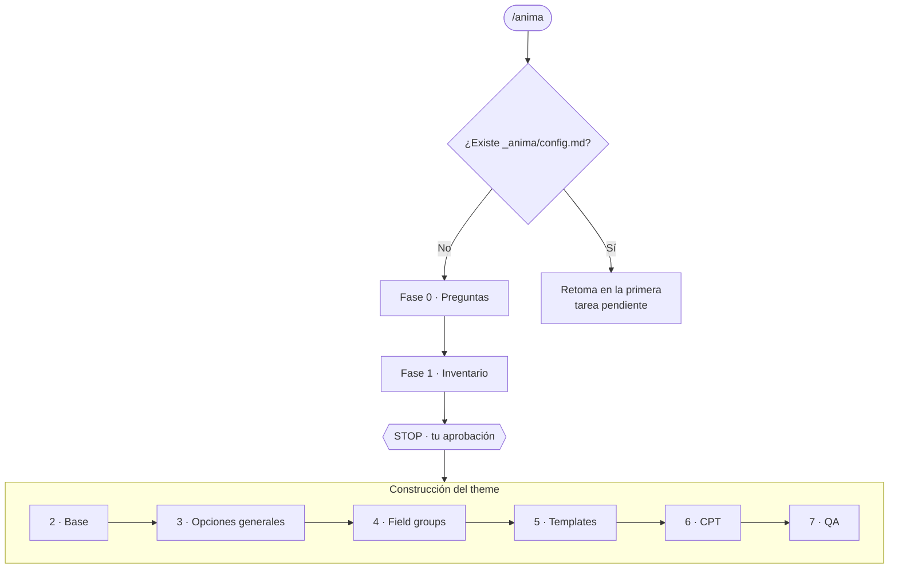

<div align="center">

# Ánima

**De sitio estático a theme WordPress 100% administrable.**

Agent Skill para Cursor que convierte un sitio HTML/CSS/JS en un theme clásico de WordPress,
con contenido editable vía Secure Custom Fields o ACF PRO, visualmente idéntico al original.

[](https://github.com/alexiscontrerasv/anima-wp/actions/workflows/validate.yml)
[](https://github.com/alexiscontrerasv/anima-wp/releases)
[](LICENSE)
[](https://agentskills.io)

</div>

---

## ¿Qué hace?

Escribes `/anima` en el chat de Cursor y el agente:

1. **Revisa tu proyecto** y detecta la fuente estática, los themes existentes, los plugins instalados y WP-CLI.
2. **Te hace las preguntas de configuración** en un solo mensaje (nombre del theme, rutas, plugin de campos, SEO, idioma…), con valores ya propuestos.
3. **Inventaría el sitio estático** y te propone el modelo de contenido completo. Se detiene hasta que lo apruebes.
4. **Construye el theme por fases**: base, Opciones generales, field groups, templates, CPT y QA.
5. **Deja todo registrado** en `_anima/` para retomar en cualquier chat con `/anima`.

### Lo que obtienes

- Theme WordPress clásico (PHP) siguiendo los WordPress Coding Standards.
- Field groups, options page, CPT y taxonomías como **Local JSON versionado** (`acf-json/`).
- Página **"Opciones generales"** para datos globales (RRSS, contacto, footer).
- Menús nativos desde **Apariencia → Menús**.
- **Salida segura** en todo el theme (`esc_html`, `esc_url`, `wp_kses_post`…) y secciones vacías que no dejan wrappers.
- Un **inventario** y un **registro de progreso** con cada decisión y su motivo.

## Cómo funciona



| Fase | Qué hace | Termina cuando |
|---|---|---|
| 0 · Configuración | Detecta el entorno y pregunta lo necesario | Respondes las preguntas |
| 1 · Inventario | Analiza el estático y propone el modelo de contenido. **No escribe código** | **Apruebas** el inventario |
| 2 · Base del theme | `style.css`, `functions.php`, `inc/`, assets, header y footer con menús | El theme activa sin errores |
| 3 · Opciones generales | Options page + field group global | Un cambio en el admin se refleja en el front |
| 4 · Field groups | Un JSON por plantilla o CPT | Los campos aparecen en las páginas correctas |
| 5 · Templates y secciones | Una sección PHP por bloque del diseño | Cada página se ve igual al estático |
| 6 · CPT y taxonomías | Solo si el inventario lo justifica | Listados y detalles funcionando |
| 7 · QA | `php -l`, PHPCS, búsqueda de hardcodeos y salidas sin escapar | Reporte final en `PROGRESS.md` |

Puedes elegir entre modo **continuo** (solo se detiene en los STOP y ante dudas bloqueantes) o **fase a fase**.

## Requisitos

- **[Cursor](https://cursor.com)** con soporte para Agent Skills.
- Un **WordPress local** (LocalWP, DDEV, Docker, Laragon, etc.).
- **[Secure Custom Fields](https://wordpress.org/plugins/secure-custom-fields/)** o **ACF PRO**. ACF gratuito no sirve: no incluye Repeater ni Options Pages.
- **WP-CLI** (opcional). Sin él, la sincronización de campos se hace desde el admin.
- El sitio estático en una carpeta del proyecto.

## Instalación

### Opción A — CLI de skills (recomendada)

```bash
npx skills add alexiscontrerasv/anima-wp -g
```

El flag `-g` lo instala para todos tus proyectos. Sin él, queda solo en el proyecto actual.

### Opción B — Manual

1. Descarga `anima-vX.Y.Z.zip` desde [Releases](https://github.com/alexiscontrerasv/anima-wp/releases).
2. Descomprímelo dentro de tu carpeta de skills de Cursor:

| Sistema | Ruta |
|---|---|
| Windows | `C:\Users\<usuario>\.cursor\skills\` |
| macOS / Linux | `~/.cursor/skills/` |

Debe quedar así: `.cursor/skills/anima/SKILL.md`. El nombre de la carpeta tiene que ser exactamente `anima`.

### Opción C — Clonar y enlazar (para recibir actualizaciones con `git pull`)

**macOS / Linux**
```bash
git clone https://github.com/alexiscontrerasv/anima-wp.git
mkdir -p ~/.cursor/skills
ln -s "$(pwd)/anima-wp/skills/anima" ~/.cursor/skills/anima
```

**Windows (PowerShell)**
```powershell
git clone https://github.com/alexiscontrerasv/anima-wp.git
New-Item -ItemType Directory -Force "$HOME\.cursor\skills" | Out-Null
New-Item -ItemType Junction -Path "$HOME\.cursor\skills\anima" -Target "$PWD\anima-wp\skills\anima"
```

### Para todo un equipo

Copia `skills/anima/` en `.cursor/skills/anima/` dentro del repositorio del proyecto y haz commit. Todos los que clonen el proyecto tendrán `/anima` disponible.

### Verificar

Reinicia Cursor y escribe `/` en el chat del agente: debería aparecer `anima`. También lo verás en **Cursor Settings → Rules, Skills, Subagents**.

## Uso

| Comando | Qué hace |
|---|---|
| `/anima` | Inicia un proyecto nuevo o retoma el existente desde la primera tarea pendiente |
| `/anima estado` | Muestra fase actual, pendientes y dudas. No modifica nada |
| `/anima nuevo` | Inicia una configuración nueva aunque ya exista una |
| `/anima <texto>` | Usa el texto como contexto o instrucción adicional |

> **Sesiones largas:** un skill invocado con `/` se adjunta a un solo mensaje. Para mantenerlo activo toda la sesión, actívalo como **Custom Mode** (`Alt+Enter` en Windows / `Option+Enter` en macOS). Si abres un chat nuevo, basta con escribir `/anima` otra vez: el progreso queda guardado en `_anima/PROGRESS.md`.

### Ejemplo de arranque

```text
Ánima v1.0.0 · por Alexis Contreras

Detecté lo siguiente. Responde "ok a todo" o corrige solo lo necesario:

1. Nombre del theme ............ [Café Alerce]
2. Slug ........................ [cafe-alerce]
   → prefijo: cafe_alerce_ · text domain: cafe-alerce · keys: cafealerce
3. Fuente estática ............. [wp-content/themes/cafe-alerce/static/]
4. Theme destino ............... [wp-content/themes/cafe-alerce/]
5. Plugin de campos ............ [SCF]
6. Plugin SEO .................. [Yoast SEO]
7. Idioma de campos ............ [español]
8. Autor del theme ............. [?]
9. PHP mínimo .................. [8.1]
10. Modo de avance ............. [continuo]
11. Entorno local .............. [LocalWP · http://cafe-alerce.local · WP-CLI: sí]
```

## Estructura generada

```text
cafe-alerce/
├── style.css
├── functions.php
├── inc/                  # setup, enqueue, custom-fields, helpers, walkers
├── acf-json/             # field groups, options page, CPT y taxonomías
├── template-parts/
│   ├── header/  footer/
│   └── sections/
├── templates/            # page templates
├── assets/               # css, js, img y fuentes del estático
├── header.php  footer.php  front-page.php  page.php  index.php  404.php
└── _anima/               # estado de Ánima (excluir del deploy)
    ├── config.md
    ├── INVENTORY.md
    └── PROGRESS.md
```

## Principios

- **No inventa.** Si no está en el estático o en el inventario aprobado, no se crea. Si duda de que una función, hook o comando exista, lo registra como `DUDA:` y pregunta.
- **La fuente estática es de solo lectura.** Nunca se modifica, mueve ni borra.
- **Solo entorno local.** Verifica la URL antes de ejecutar WP-CLI y nunca opera contra staging o producción.
- **Mínimo de campos necesario.** El microcopy va con `__()`, y lo que WordPress ya entrega no se duplica en campos.
- **Nada fuera del theme sin aprobación**, y nunca lee ni expone `wp-config.php`, `.env` ni credenciales.

## Alcance y limitaciones

- Genera **themes clásicos (PHP)**. No genera block themes (FSE) ni bloques de Gutenberg.
- No carga el contenido en WordPress ni hace deploy.
- El código lo escribe un modelo de IA: **revísalo** antes de llevarlo a producción. Las fases con STOP y el QA final existen para eso.
- Está diseñado para **Cursor**. Otras herramientas compatibles con el formato [Agent Skills](https://agentskills.io) podrían cargarlo, pero no está verificado.
- El skill está escrito en español. El idioma de los campos se elige en la configuración.

## Seguridad

Un skill son instrucciones que el agente ejecuta con sus propios permisos. Lee [`SKILL.md`](skills/anima/SKILL.md) antes de instalarlo, como harías con cualquier skill. Para reportar un problema de seguridad, revisa [SECURITY.md](SECURITY.md).

## Preguntas frecuentes

<details>
<summary><strong>No aparece <code>/anima</code> en Cursor</strong></summary>

Revisa que la ruta sea `.cursor/skills/anima/SKILL.md` (la carpeta debe llamarse igual que el campo `name`), reinicia Cursor y confirma que aparece en **Cursor Settings → Rules, Skills, Subagents**.
</details>

<details>
<summary><strong>¿Por qué no se activa solo?</strong></summary>

Tiene `disable-model-invocation: true` a propósito. Como suele instalarse para todos los proyectos, se activa únicamente cuando escribes `/anima`, y no cada vez que trabajas en un proyecto WordPress.
</details>

<details>
<summary><strong>¿Puedo usar otro nombre de comando?</strong></summary>

Sí. Renombra la carpeta y cambia el campo `name` en el frontmatter de `SKILL.md`. Deben coincidir.
</details>

<details>
<summary><strong>¿Sirve para un sitio que ya está en WordPress?</strong></summary>

No es su objetivo. Ánima parte de HTML/CSS/JS estático. Para rehacer un theme existente, primero exporta el diseño como estático.
</details>

## Contribuir

Las sugerencias y mejoras son bienvenidas. Revisa [CONTRIBUTING.md](CONTRIBUTING.md) antes de abrir un PR. Los cambios de cada versión están en el [CHANGELOG](CHANGELOG.md).

## Licencia

[MIT](LICENSE) © 2026 Alexis Contreras.
Puedes usarlo, modificarlo y distribuirlo libremente, manteniendo el aviso de copyright y la licencia.

## Autor

**Alexis Contreras** · [GitHub](https://github.com/alexiscontrerasv) · [aledev.cl](https://aledev.cl)

---

### English summary

**Ánima** is a Cursor Agent Skill that turns a static HTML/CSS/JS site into a fully editable classic WordPress theme using Secure Custom Fields or ACF PRO (Local JSON, an options page, native menus and escaped output everywhere). Type `/anima`: it asks a few setup questions, inventories the static site, waits for your approval, then builds the theme phase by phase, keeping its state in `_anima/` so it can resume in any chat. The skill's instructions are written in Spanish. Install with `npx skills add alexiscontrerasv/anima-wp -g`. MIT licensed.
